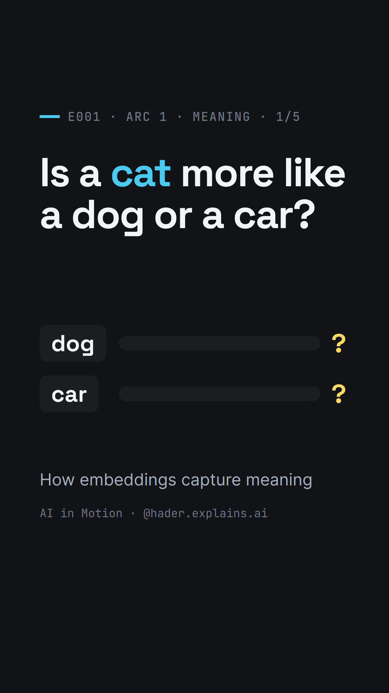

# E001 — Is a cat more like a dog or a car?

> **Track:** Mathematical Foundations & Machine Learning · **Arc 1** (How does a machine represent meaning?) · 1/5 ·
> **Video:** [Instagram](https://www.instagram.com/reel/DfPTbNbt_SF/) · [LinkedIn](https://www.linkedin.com/posts/hader-azzini_machinelearning-ai-nlp-ugcPost-7522998370001498112-Bxsm/)



## The question
You know at once that a *cat* is more like a *dog* than a *car*. A computer does not see animals or engines — it sees
letters. And by letters, *cat* and *car* are just one letter apart, while *cat* and *dog* share none. So how can a
model end up saying that *cat* is closer to *dog*?

## The short answer
Describe each word not by its spelling but by **the words that appear around it**. Cats get chased and fed; so do
dogs; cars need fuel. Write those neighbours down as numbers, one list per word — a **vector** — and words used in
similar contexts get similar vectors. Real models learn such vectors from billions of words of text; each word ends
up as a short list of numbers, a **word embedding**. In GloVe, the similarity of *cat* and *dog* is 0.92; of *cat*
and *car*, 0.36.

> "You shall know a word by the company it keeps." — J. R. Firth, 1957

## The math
**A word as a vector.** Count how often each neighbouring word appears near a word (toy counts, for illustration):

| | *chased* | *fed* | *fuel* |
|---|---|---|---|
| **cat** | 3 | 2 | 0 |
| **dog** | 2 | 3 | 0 |
| **car** | 0 | 0 | 4 |

Each row is a vector: $\mathbf{cat} = (3, 2, 0)$, $\mathbf{dog} = (2, 3, 0)$, $\mathbf{car} = (0, 0, 4)$.

**Dot product.** Multiply coordinate by coordinate and add:

$$\mathbf{u}\cdot\mathbf{v} = \sum_i u_i v_i$$

$\mathbf{cat}\cdot\mathbf{dog} = 3\times2 + 2\times3 + 0\times0 = 12$, while $\mathbf{cat}\cdot\mathbf{car} = 0$: shared
neighbours add up, unshared ones contribute nothing.

**Cosine similarity.** Real models compare vectors by the **angle** between them, which is the dot product after
scaling both vectors to length 1:

$$\cos\theta = \frac{\mathbf{u}\cdot\mathbf{v}}{\lVert\mathbf{u}\rVert\,\lVert\mathbf{v}\rVert} \in [-1, 1]$$

With GloVe 50-d vectors, the raw dot products are $\mathbf{cat}\cdot\mathbf{dog} = 19.74$ and
$\mathbf{cat}\cdot\mathbf{car} = 9.19$; the lengths are 4.41 (*cat*), 4.86 (*dog*) and 5.73 (*car*), so
$\cos(\textit{cat}, \textit{dog}) = 19.74 / (4.41 \times 4.86) = 0.92$ and
$\cos(\textit{cat}, \textit{car}) = 9.19 / (4.41 \times 5.73) = 0.36$. Why the angle and not the raw sum is the
subject of E002.

## The mechanism, visually
The video keeps one test on screen — *More like cat? dog / car* — and scores every attempt on it:

1. **Letters:** *car* wins (one letter apart). The cause: letters carry spelling, not meaning.
2. **The words around them:** *cat* and *dog* share *chased* and *fed*; *car* only has *fuel*. In a table, *cat* and
   *dog* fill the same columns — *dog* wins, for the right reason.
3. **Counts → vectors → dot product:** each row is a vector; multiply and add gives 12 for *dog*, 0 for *car*.
4. **At scale:** a real table has a row and a column for every word — 400,000 words in GloVe, counted over about
   6 billion words of text. The model squeezes each row into a short list: *cat* in 50 numbers. They are no longer
   counts — 21 of the 50 are negative.
5. **Real scores:** similarity 0.92 for *dog*, 0.36 for *car*. These scores measure an angle — why? → E002.

## Where engineers meet this
Embeddings are the first step of search engines and chatbots: text is turned into vectors, and "similar meaning"
becomes "nearby vectors". With a modern sentence encoder (all-MiniLM-L6-v2), the query *"I forgot my login
credentials"* ranks *"To change your password, open Settings and choose Security."* first (cosine 0.49) — although
the two share no words. This is the retrieval step of RAG (E003–E004).

## Run it
```bash
cd code
uv run main.py
```
Downloads GloVe 50-d (~66 MB) and all-MiniLM-L6-v2 once into `code/.cache/`, then prints and writes
`results.json`: the toy dot products, GloVe similarities, raw dot products and lengths, *cat*'s 50 numbers, nearest
neighbours, the analogy check, and the MiniLM search example. Runs on CPU.

## Simplifications and limitations
- **Toy table.** The counts (3, 2, 0 …) are illustrative, not counted from a corpus.
- **Coordinates are not words.** GloVe's 50 numbers are not individual neighbouring words; GloVe learns all vectors
  together so that their dot products (plus a bias per word) fit the logarithm of the co-occurrence counts — a
  compression of the full table (related to matrix factorization [Levy14]). That is also why some numbers are negative.
- **Tokens ≈ words.** The ~6 billion are tokens (words, numbers, punctuation).
- **"Meaning" = similarity of use.** Embeddings capture how words are used, which is related to meaning but not the
  same: *hot* and *cold* are close (0.80), because they appear in the same contexts (E005).
- **One vector per word.** Static embeddings give *bank* (river) and *bank* (money) the same vector; contextual models
  fix this (Arc 2).
- **Bias.** Embeddings inherit the biases of their training text; analogy demos can exaggerate them: *king − man +
  woman* gives *queen* only when the input words are excluded from the answer [Nissim20].
- **Scores are model-specific.** Cosine values are comparable only within one model (GloVe 0.92 vs MiniLM 0.66 for
  *cat*/*dog*).

## References
- Z. S. Harris (1954). Distributional Structure. *Word*, 10(2–3), 146–162.
- J. R. Firth (1957). A synopsis of linguistic theory 1930–1955. In *Studies in Linguistic Analysis*, 1–32.
- T. Mikolov, K. Chen, G. Corrado, J. Dean (2013). Efficient Estimation of Word Representations in Vector Space.
  arXiv:1301.3781.
- J. Pennington, R. Socher, C. D. Manning (2014). GloVe: Global Vectors for Word Representation. EMNLP, 1532–1543.
- [Levy14] O. Levy, Y. Goldberg (2014). Neural Word Embedding as Implicit Matrix Factorization. NIPS 27.
- N. Reimers, I. Gurevych (2019). Sentence-BERT. EMNLP-IJCNLP. arXiv:1908.10084.
- P. Lewis et al. (2020). Retrieval-Augmented Generation for Knowledge-Intensive NLP Tasks. NeurIPS. arXiv:2005.11401.
- [Nissim20] M. Nissim, R. van Noord, R. van der Goot (2020). Fair Is Better than Sensational. *Computational
  Linguistics*, 46(2). arXiv:1905.09866.
- D. Jurafsky, J. H. Martin. *Speech and Language Processing*, 3rd ed. draft, "Vector Semantics and Embeddings".

---
Text and figures: CC BY 4.0 · Code: MIT · © Hader Azzini
