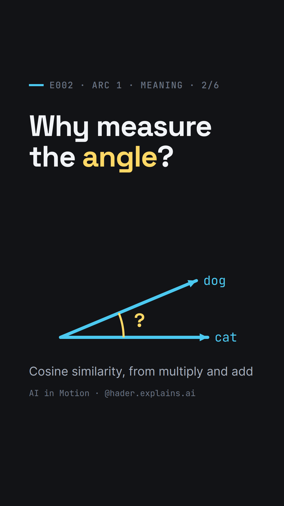

# E002 — Why measure the angle?

> **Track:** Mathematical Foundations & Machine Learning · **Arc 1** (How does a machine represent meaning?) · 2/6 ·
> **Video:** [Instagram](https://www.instagram.com/reel/DfVIjTgtpg3/) · [LinkedIn](https://www.linkedin.com/posts/hader-azzini_machinelearning-ai-nlp-ugcPost-7523819503214948352-UUyF/)



## The question
In E001, *cat* came out closer to *dog* than to *car*: multiply the two rows of counts number by number, add, and the
bigger score wins. But the real scores (0.92 and 0.36) were not that sum — they measured an **angle**. Why would a
model throw the plain sum away and compare words by the angle between their arrows?

## The short answer
The plain sum rewards **frequency**. A word that shows up everywhere has big counts in every column, so it wins every
comparison without being like anything. Dividing each row by its **length** takes frequency out: every arrow gets
length 1, and the only thing left to tell two words apart is the angle between them. The shadow one length-1 arrow
casts on the other measures that angle — it is the **cosine** of the angle, and for length-1 arrows it is exactly
multiply and add again. That is **cosine similarity**.

## The math
**The problem.** E001's toy table (illustrative counts), plus *it*, a word that shows up everywhere:

| | *chased* | *fed* | *fuel* | length |
|---|---|---|---|---|
| **cat** | 3 | 2 | 0 | 3.61 |
| **dog** | 2 | 3 | 0 | 3.61 |
| **car** | 0 | 0 | 4 | 4 |
| **it** | 10 | 10 | 10 | 17.32 |

Multiply and add (the dot product, $\mathbf{u}\cdot\mathbf{v} = \sum_i u_i v_i$): $\mathbf{cat}\cdot\mathbf{dog} = 12$,
but $\mathbf{cat}\cdot\mathbf{it} = 3\times10 + 2\times10 + 0\times10 = 50$. *It* also beats everything for *dog* (50)
and for *car* (40). The tens do the work: the score grows with the size of the numbers, not only with what the rows
share.

**Length.** By Pythagoras, the length of a row is the square root of the sum of its squares:

$$\lVert\mathbf{u}\rVert = \sqrt{\sum_i u_i^2}$$

So $\lVert(3, 2, 0)\rVert = \sqrt{13} \approx 3.61$ and $\lVert(10, 10, 10)\rVert = \sqrt{300} \approx 17.32$.

**The fix.** Divide each row by its length. Every arrow now has length 1: *cat* (0.83, 0.55, 0), *dog*
(0.55, 0.83, 0), *car* (0, 0, 1), *it* (0.58, 0.58, 0.58). Multiply and add the new rows and you get the cosine of
the angle between the original ones:

$$\cos\theta = \frac{\mathbf{u}\cdot\mathbf{v}}{\lVert\mathbf{u}\rVert \lVert\mathbf{v}\rVert} \in [-1, 1]$$

| Pair | Multiply and add | Cosine |
|---|---|---|
| cat · dog | 12 | 0.92 |
| cat · car | 0 | 0 |
| cat · it | 50 | 0.80 |
| dog · it | 50 | 0.80 |
| car · it | 40 | 0.58 |

*Dog* is back on top for *cat*. (In the video, $0.83\times0.55 + 0.55\times0.83$ is written "≈ 0.92": with the
rounded two-decimal rows it gives 0.913; unrounded, 0.923.)

**Why the shadow is multiply and add** (stated in the video, proved here). Any two arrows, with 3 numbers or 50, lie
on one flat sheet through the origin, so they make one angle $\theta$. Take two length-1 arrows and turn the sheet
until the first lies along the first axis: $\mathbf{u} = (1, 0)$, $\mathbf{v} = (\cos\theta, \sin\theta)$. The shadow
of $\mathbf{v}$ on $\mathbf{u}$ is the side next to the angle in a right triangle with hypotenuse 1: $\cos\theta$.
Multiply and add gives $1\times\cos\theta + 0\times\sin\theta = \cos\theta$ — the same number. Turning both arrows
together changes neither their lengths nor the distance between them, and the dot product is fixed by those three:

$$\mathbf{u}\cdot\mathbf{v} = \frac{\lVert\mathbf{u}\rVert^2 + \lVert\mathbf{v}\rVert^2 - \lVert\mathbf{u}-\mathbf{v}\rVert^2}{2}$$

So turning does not change the dot product either. Hence, for any two length-1 arrows, multiply and add = shadow =
$\cos\theta$: 1 for the same direction, 0 for a right angle.

**A real model.** In GloVe 50-d, *cat* has length 4.41 and *dog* 4.86. Divide each by its length, multiply the 50
pairs of numbers and add: 0.92. *Cat* and *car*: 0.36. The same frequency effect exists in GloVe, but it is weak:
$\mathbf{dog}\cdot\mathbf{you} = 20.04$ beats $\mathbf{dog}\cdot\mathbf{cat} = 19.74$ because *you* is a longer arrow
(6.40); by cosine, *cat* wins (0.92 vs 0.65).

## The mechanism, visually
The video keeps E001's test — *More like cat?* — and breaks it:

1. **Recall:** E001's table; multiply and add gives *dog* 12, *car* 0.
2. **Add *it*:** it got chased, it was fed, it needs fuel — a row of tens.
3. **Break:** *it* wins every scoreboard: 50, 50, 40.
4. **Cause:** in cat·it the tens do the work; *it* wins by showing up often. As arrows, *it* is the longest.
5. **Fix:** a length column; each row is divided by its length; every length becomes 1.
6. **Angle:** only the angle is left; two arrows always lie on one flat sheet.
7. **Shadow:** an arrow swings away from *cat*; its shadow shrinks from 1 to 0 at a right angle (*car*).
8. **Name it:** shadow = cos(angle) = cosine similarity; for length-1 arrows, shadow = multiply and add.
9. **Real model:** GloVe's 50 numbers for *cat* and *dog*, divided, multiplied and added: 0.92.
10. **Open:** 21 of *cat*'s 50 numbers are negative — a word can't show up −1 times. So what are they? → E003.

## Where engineers meet this
Search systems and vector databases compare embeddings by cosine, and they make it cheap by dividing by the length
only once. FAISS stores length-1 vectors and then ranks by plain multiply and add (inner product); encoders such as
all-MiniLM-L6-v2 end with a normalisation layer, so their vectors already have length 1 — *cat*·*dog* = 0.661, which
is also their cosine. For length-1 vectors the distance gives the same ranking too, because with lengths 1 the formula above gives

$$\lVert\mathbf{u}-\mathbf{v}\rVert^2 = 2 - 2\cos\theta$$

## Run it
```bash
cd code
uv run main.py
```
Downloads GloVe 50-d (~66 MB) and all-MiniLM-L6-v2 once into `code/.cache/`, then prints and writes `results.json`:
the toy table with *it* (dot products, lengths, length-1 rows, cosines), GloVe's *cat*/*dog* step by step, dot
product vs cosine vs distance on real pairs, the share of negative numbers, and the MiniLM check. Runs on CPU.

## Simplifications and limitations
- **Toy table.** The counts, including *it*'s tens, are illustrative, not counted from a corpus. The mechanism
  (frequent words have longer count vectors and win the raw dot product) is from [JM] §5.4.
- **Pictures are schematic.** The 3-D arrows are drawn obliquely; the flat sheet is a drawing, not a projection of
  the real 50-d vectors; in shot 09 the real numbers are shown as bars.
- **The toy 0.92 and GloVe's 0.92 are a coincidence.** One is a made-up table (0.923), the other a trained model
  (0.922).
- **Cosine ignores length completely.** In some systems length carries information and is kept on purpose.
- **Not every system uses cosine.** Some retrieval models are trained for the raw dot product [JM] ch. 11.
- **A small angle means "used alike", not "same meaning":** *hot* and *cold* score 0.80 (E006).
- **A negative cosine is not "opposite meaning":** *cat*'s most negative words in GloVe are unrelated names
  (*vitaly* −0.48, *zbigniew* −0.44).

## References
- D. Jurafsky, J. H. Martin. *Speech and Language Processing*, 3rd ed. draft (Aug 2026), ch. 5 "Embeddings", §5.4
  "Cosine for Measuring Similarity"; ch. 11 "Information Retrieval and RAG". https://web.stanford.edu/~jurafsky/slp3/
- G. Strang. *Introduction to Linear Algebra*, 5th ed., Wellesley-Cambridge Press, 2016. §1.2 "Lengths and Dot
  Products".
- J. Pennington, R. Socher, C. D. Manning (2014). GloVe: Global Vectors for Word Representation. EMNLP, 1532–1543.
- N. Reimers, I. Gurevych (2019). Sentence-BERT. EMNLP-IJCNLP. arXiv:1908.10084. Model:
  https://huggingface.co/sentence-transformers/all-MiniLM-L6-v2
- Meta AI. FAISS wiki, "MetricType and distances".
  https://github.com/facebookresearch/faiss/wiki/MetricType-and-distances

---
Narration voice generated with HeyGen from the episode's script.

Text and figures: CC BY 4.0 · Code: MIT · © Hader Azzini
